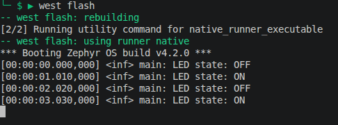
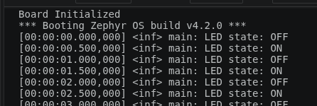

# Zephyr Training Environment

Welcome to the Zephyr RTOS training! This repository uses Zephyr 4.2.0 and
Zephyr SDK 0.17.4. It includes a west manifest for fetching the required
Zephyr dependencies.

## Manifest Setup

Create a virtual environment.
Install west and initialize or update the workspace from the workspace root:

```sh
pip install west
west update
```

The manifest pins Zephyr to `v4.2.0` and places it, together with the selected
modules, under `deps/`.

## Zephyr SDK

Download and extract [Zephyr SDK 0.17.4](https://github.com/zephyrproject-rtos/sdk-ng/releases/tag/v0.17.4), then run:

```sh
cd zephyr-sdk-0.17.4
./setup.sh
```

Build the application with the native simulator:

```sh
west build -p always -b native_sim zephyr-course/app
```

then flash the application

```sh
west flash
```

After that, the following boot head should be shown:



---

## Custom boards

### Copy/Rename method

To complete the assignment 1 of the module 5, a custom board is created using the "Copy/Rename" method.
In my case, the custom board will be created based on the FRDM-RW612.
The custom board will be named as "MOD5-ASSGNMNT1".
To build the `app` for this method use

```sh
west build -b mod5_assgnmnt1 -p app
```

and to flash simply use

```sh
west flash
```

Remark: for other boards such as the the FRDM-MCXA159, the flash operation requires `LinkServer`. Therefore, first install it and then ensure that is in the PATH.
As an example, if the `LinkServer` executable is in `/usr/local/LinkServer`, then:

```sh
export PATH=$PATH:/usr/local/LinkServer
```

### From Scratch method

To complete the assignment 2 of the module 5, a custom board is created using the "From Scratch" method.
In my case, the custom board will be created based on the FRDM-RW612.
The custom board will be named as "MOD5-ASSGNMNT2".
To build the `app` for this method use

```sh
west build -b mod5_assgnmnt2 -p app
```

and to flash simply use

```sh
west flash
```

Remark: for other boards such as the the FRDM-MCXA156, the flash operation requires `LinkServer`. Therefore, first install it and then ensure that is in the PATH.
As an example, if the `LinkServer` executable is in `/usr/local/LinkServer`, then:

```sh
export PATH=$PATH:/usr/local/LinkServer
```

To see console messages printed from the board there are various ways.
One of the simplest is to ensure that the linux user account has the correct privileges and then:

- install the "Serial Monitor" extension `ms-vscode.vscode-serial-monitor`
- select the port. Example: `/dev/ttyACM0`
- select the baudrate. Example `1152000`

In this case, the "Board Initialized" message can be seen:



Another way to communicate with the board is to use `minicom`. This utility can be installed natively only on Linux.
Then, simply open a terminal and then:

```bash
minicom -D /dev/tty<add here the device name> --color=on
```

## Custom shell commands

```bash
l7_custom_shell_cmds fetch l6task1_sensor
l7_custom_shell_cmds read l6task1_sensor
l7_custom_shell_cmds info l6task1_sensor
l7_custom_shell_cmds set l6task1_sensor <value in range [0-3]>
```

## Open questions

- How to express dependency between a driver and a protocol (such as I2C) or GPIO pins?
  - in the driver implementation of the sensor in the [linked article](https://bootlin.com/blog/zephyr-implementing-a-device-driver-for-a-sensor/) as well as in the slides:

    ```Kconfig
        # inside the driver's Kconfig
        config LSM9DS1
            bool "LSM9DS1 I2C accelerometer and gyroscope chip"
            default y
            depends on DT_HAS_ST_LSM9DS1_ENABLED
            select I2C # expresses the dependency to the I2C and auto-pulls dependencies
    ```

  - for the L6-Task1 using `select GPIO` alone **wasn't sufficient**, as the LED on the board wasn't blinking. Instead explicitly defining a higher priority was necessary, at least for the FRDM-MXCA156 board
  - similarly, as best practice, is there a way to express the comment in the `l6task1,driver.yaml` in a way Zephyr understands?
  `# This driver requires a GPIO device aliased as 'app_led' for LED control`

- Is possible to reference another Kconfig symbol from within a range of another Kconfig symbol?
  Example: the following doesn't build

  ```Kconfig
    menuconfig L6TASK1_DRIVER
        bool "L6 Task1 Driver"
        default y
        depends on DT_HAS_L6TASK1_DRIVER_ENABLED
        help
            Enable the L6 Task1 custom driver for the I2C peripheral

    if L6TASK1_DRIVER

    config L6TASK1_DRIVER_INIT_PRIORITY
        int "L6TASK1 driver initialization priority"
        default CONFIG_GPIO_INIT_PRIORITY
        help
            Initialization priority for the L6TASK1 driver.

    endif # L6TASK1_DRIVER
  ```

## Further resources

- [Getting Started Guide - Zephyr 4.2.0 documentation](https://docs.zephyrproject.org/4.2.0/develop/getting_started/index.html)
